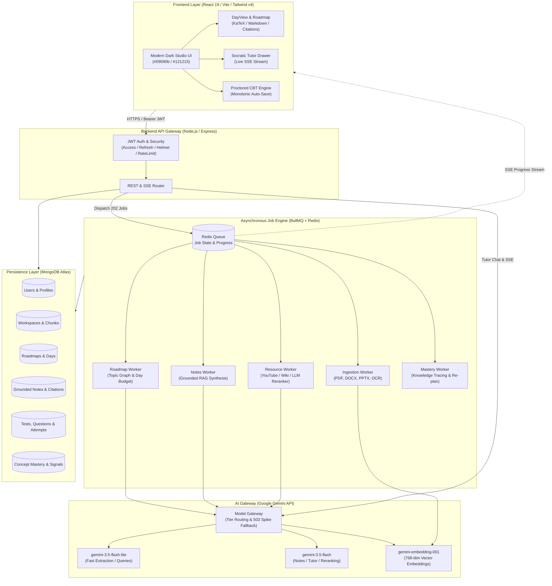

# AlgoPrep v2.0

> **AlgoPrep** is an enterprise-grade, AI-powered adaptive computer science study and examination platform. It transforms raw academic materials (lecture notes, syllabi, textbooks, and slide decks) into personalized, day-by-day mastery roadmaps featuring grounded study notes, curated multi-source multimedia resources, live Socratic AI tutoring, and proctored computer-based examinations (CBT).


---


## ✨ Key Architectural Features

### 1. 📚 Multi-Format Asynchronous Ingestion (BullMQ + Redis)
- **Format Support**: Multi-page PDF extraction via `unpdf` and `pdf-parse`, DOCX via `mammoth`, PPTX slide-by-slide parsing, and image OCR via `tesseract.js`.
- **Intelligent Chunking**: Sliding window boundary chunker (400–800 tokens, 100-token overlap) preserving document hierarchy (page, slide, section heading).
- **Resilient Background Queues**: Offloaded to BullMQ worker pools running over Redis with exponential backoff retries, batch embedding pacing (16 items/batch with 600ms delay), and real-time SSE progress streaming.

### 2. 🗺️ Intelligent Roadmap & Adaptive Day Planning
- **Pedagogical Structuring**: Synthesizes custom curricula based on student target exam dates and daily time constraints (e.g. 60–120 mins/day).
- **Topological Sorting**: Enforces strict concept dependencies (e.g., *Linear Algebra & Gradient Descent* $\rightarrow$ *Backpropagation* $\rightarrow$ *CNNs*).
- **Buffer & Synthesis Days**: Automatically reserves review days and milestone mock exams.

### 3. 📖 Grounded Study Notes with Verified Citations & Math
- **Hallucination-Resistant Synthesis**: LLM sections are generated strictly using retrieved passages. If supplementary concepts are required, they are visibly badged as `Supplemented Theory`.
- **Interactive Citation Cards**: Inline markers (`[C1]`, `[C2]`) open modal drawers displaying verified source material snippets and page/slide locations.
- **Rich Scientific Typography**: Fully rendered KaTeX mathematical notation (e.g., $T, E, P$, $\rightarrow$, loss gradients) and styled GitHub Flavored Markdown (GFM) comparison tables.

### 4. 🎯 Multi-Source Educational Resource Ranking
- **Parallel Adapters**: Gathers learning assets from the YouTube Data API v3, Wikipedia REST Summary API, OpenLibrary, and ArXiv.
- **Two-Stage Hybrid Scoring**:
  $$\text{Final Score} = 0.4 \cdot \text{Relevance} + 0.2 \cdot \text{Quality} + 0.4 \cdot \text{LLM Rerank}$$
- **Quota-Aware Caching**: Stores normalized candidate rankings in MongoDB with a 7-day TTL cache to protect third-party API quotas.

### 5. ⏱️ Zero-Trust CBT Engine & Anti-Cheat System
- **Server-Authoritative Countdown**: Strict server-side deadline tracking immune to client system clock manipulation.
- **Monotonic Version Locking**: Prevents race conditions and out-of-order state overwrites during concurrent network reconnects.
- **Proctoring Telemetry**: Detects tab-switching, window blur, and fullscreen exits via the HTML5 Page Visibility API.
- **Pre-Seeded Platform Assessments**: 25 comprehensive Computer Science topic exams (375 questions) covering OS, DBMS, Networks, Data Structures, Algorithms, and System Design.

### 6. 🧠 Knowledge Tracing & Dynamic Re-Planning
- **Mastery Scoring**: Calculates mastery per concept ($0.0 \rightarrow 1.0$) using weighted accuracy, difficulty scales, and behavioral signals (`fast_wrong`, `slow_wrong`, `marked_for_review`).
- **SM-2 Spaced Repetition**: Automatically computes `nextReviewAt` intervals (1 $\rightarrow$ 3 $\rightarrow$ 7 days).
- **Deterministic Re-Planner**: When concept mastery drops below 0.60, AlgoPrep dynamically injects a 5-question Revision Quiz into future roadmap days.

### 7. 🤖 Socratic AI Study Tutor
- **SSE Streaming**: Real-time token streaming with automatic fallback from `gemini-3.5-flash` to `gemini-3.5-flash-lite`.
- **Tool-Calling Architecture**: The tutor inspects student context using structured function tools (`searchMaterials`, `getTodayPlan`, `getWeakConcepts`, `getAttemptMistakes`).
- **Academic Integrity Guardrails**: Automatically inspects active test attempts and refuses to divulge direct answers during live examinations.

---

## 🏗️ System Architecture & Data Flow



---


## 📡 API Overview & Endpoints

All protected endpoints require an `Authorization: Bearer <token>` header.

### 📂 Workspaces & Material Ingestion
| Method | Endpoint | Description |
| :--- | :--- | :--- |
| `POST` | `/api/workspaces` | Create new study workspace |
| `GET` | `/api/workspaces` | List user workspaces with material counts |
| `GET` | `/api/workspaces/:id` | Get workspace details, status, and material metadata |
| `DELETE`| `/api/workspaces/:id` | Cascade delete workspace, materials, chunks, roadmap, notes |
| `POST` | `/api/workspaces/:id/materials` | Upload material file (PDF, DOCX, PPTX, Image) → Enqueues ingestion |
| `GET` | `/api/jobs/:jobId/stream` | **SSE Stream**: Real-time progress updates for ingestion & synthesis jobs |

### 🗺️ Roadmaps & Study Days
| Method | Endpoint | Description |
| :--- | :--- | :--- |
| `POST` | `/api/workspaces/:id/roadmap` | Generate structured day-by-day roadmap |
| `GET` | `/api/workspaces/:id/roadmap` | Fetch active roadmap, topic graph, and days |
| `GET` | `/api/days/:dayId` | Fetch full day payload (objectives, notes status, test status) |
| `PATCH`| `/api/days/:dayId/status` | Update study day status (`pending`, `completed`) |

### 📖 Grounded Notes & Citations
| Method | Endpoint | Description |
| :--- | :--- | :--- |
| `GET` | `/api/days/:dayId/notes` | Get generated grounded notes with citation references |
| `POST` | `/api/days/:dayId/notes/regenerate` | Force regeneration of notes using updated chunks |

### 🎯 Educational Resources
| Method | Endpoint | Description |
| :--- | :--- | :--- |
| `GET` | `/api/days/:dayId/resources` | Fetch two-stage ranked YouTube, Wikipedia & Book resources |
| `POST` | `/api/resources/:id/feedback` | Submit student relevance feedback (`helpful`, `watched`) |

### 📝 Test Engine & Attempts (Dual-Mode CBT)
| Method | Endpoint | Description |
| :--- | :--- | :--- |
| `GET` | `/api/tests` | List available platform & generated tests |
| `POST` | `/api/days/:dayId/test` | Get or dynamically synthesize day practice/exam test |
| `POST` | `/api/tests/:id/start` | Start attempt, initialize server timer, acquire lock |
| `PATCH`| `/api/attempts/:id/progress` | Auto-save progress with monotonic version lock |
| `POST` | `/api/attempts/:id/submit` | Finalize attempt, trigger scoring & mastery evaluation |
| `GET` | `/api/attempts/:id/review` | Review question answers, explanations, and chunk citations |
| `GET` | `/api/attempts/:id/analysis` | Retrieve AI analysis scorecard and mastery deltas |

### 🤖 Socratic AI Study Tutor
| Method | Endpoint | Description |
| :--- | :--- | :--- |
| `POST` | `/api/workspaces/:id/chat/sessions` | Create or retrieve tutor chat session |
| `GET` | `/api/workspaces/:id/chat/sessions` | List workspace chat sessions |
| `GET` | `/api/chat/sessions/:sid/messages` | Get conversation history |
| `POST` | `/api/chat/sessions/:sid/messages` | **SSE Stream**: Send prompt and receive streamed tutor response |

### 🏆 Leaderboards & Classroom Features
| Method | Endpoint | Description |
| :--- | :--- | :--- |
| `GET` | `/api/leaderboard` | Global & per-test rankings via `$setWindowFields` |
| `GET` | `/api/memberships/roster` | List enrolled students in educator's classroom |
| `POST` | `/api/announcements` | Publish classroom announcement |
| `POST` | `/api/messages` | Send real-time direct message |

---

## 📁 Repository Structure

```text
AlgoPrep/
├── client/                     # Frontend Application (React 19 + Vite)
│   ├── src/
│   │   ├── components/        # UI Components (CBT Engine, QuestionPalette, Timer)
│   │   │   ├── chat/          # Socratic AI Tutor Drawer & Markdown Streamer
│   │   │   └── common/        # ErrorBoundaries, Modals, Skeleton Loaders
│   │   ├── context/           # React Context (AuthContext, SocketContext)
│   │   ├── pages/             # Route Pages (DayView, WorkspaceView, Dashboard, CBT)
│   │   ├── services/          # Axios API wrappers with JWT token auto-refresh
│   │   └── types/             # TypeScript / Prop definitions
│   ├── package.json           # React 19, Tailwind v4, KaTeX, Recharts
│   └── vite.config.js         # Vite configuration with proxy rules
│
├── server/                     # Backend Application (Node.js + Express)
│   ├── src/
│   │   ├── ai/                # AI Gateway, LLM Routing, Embedder, Retriever
│   │   │   ├── prompts/       # Structured, versioned prompts for all agents
│   │   │   └── schemas/       # Zod schemas for structured JSON output
│   │   ├── config/            # DB connection, DNS resolution, Env configuration
│   │   ├── controllers/       # HTTP Request Handlers (Workspace, Day, Notes, CBT)
│   │   ├── middleware/        # JWT Auth, Zod Validation, Multer, Rate Limiting
│   │   ├── models/            # Mongoose Schemas (Workspace, Chunk, Roadmap, Test, Attempt)
│   │   ├── parsing/           # Extractors (PDF, DOCX, PPTX, OCR) and Text Chunker
│   │   ├── queue/             # BullMQ Queue Connections & Worker Initializers
│   │   ├── resources/         # Multi-Source Adapters (YouTube, Wiki) & Reranker
│   │   ├── routes/            # Express Routers
│   │   ├── seeds/             # 25 CS Platform Tests & Dev Accounts
│   │   ├── services/          # Business Logic (Tutor, Mastery, Re-plan, Notes)
│   │   ├── socket/            # WebSocket Handlers (Direct Messaging)
│   │   └── workers/           # BullMQ Workers (Ingest, Roadmap, Notes, Resources)
│   ├── tests/                 # Vitest & Supertest integration suites
│   └── package.json           # Node.js dependencies (BullMQ, Mongoose, GenAI)
│
├── utils/                     # Architectural diagrams, mock assets, and logos
├── .env.example               # Complete environment variable template
├── INTERVIEW_PREP.md          # Comprehensive System Design & Interview Guide
└── README.md                  # Master Project Documentation
```

---

## ⚡ Installation & Local Setup

### 1. Prerequisites
- **Node.js**: v20.x or higher
- **npm** or **pnpm**
- **MongoDB**: A running local MongoDB instance or a free [MongoDB Atlas](https://www.mongodb.com/cloud/atlas) cluster.
- **Redis**: A running local Redis instance (`redis://127.0.0.1:6379`) or a managed cloud Redis instance (e.g. Upstash).

### 2. Clone the Repository
```bash
git clone https://github.com/Soupal23/AlgoPrep.git
cd AlgoPrep
```

### 3. Install Dependencies
```bash
# Install root orchestration dependencies
npm install

# Install server dependencies
npm install --prefix server

# Install client dependencies
npm install --prefix client
```

### 4. Configure Environment Variables
Copy `.env.example` to `.env` in the root directory:
```bash
cp .env.example .env
```

Populate the required credentials:
```env
PORT=5000
MONGODB_URI=mongodb+srv://<user>:<password>@cluster.mongodb.net/algoprep?retryWrites=true&w=majority
REDIS_URL=redis://127.0.0.1:6379
JWT_ACCESS_SECRET=your_super_strong_jwt_access_secret_min_32_chars
JWT_REFRESH_SECRET=your_super_strong_jwt_refresh_secret_min_32_chars
GEMINI_API_KEY=your_gemini_api_key_here
NODE_ENV=development
RUN_WORKERS=true
```

### 5. Seed Core Platform Tests
Populate the database with the 25 core Computer Science platform tests (375 questions) and initial developer accounts:
```bash
npm run seed
```
*(Default dev accounts created: `admin@algoprep.com` / `admin123456`, `student@algoprep.com` / `password123`)*

### 6. Launch the Development Server
Launch both the backend API server and Vite frontend client concurrently:
```bash
npm run dev
```
- **Backend API**: `http://localhost:5000`
- **Frontend App**: `http://localhost:5173`

---

## 🧪 Testing & Quality Assurance

AlgoPrep includes comprehensive automated test suites covering CBT monotonic locking, anti-cheat validation, grounded notes generation, and AI tutor sessions.

```bash
# Run all server integration and unit tests
npm test --prefix server

# Run specific test suites
npm test --prefix server -- tests/notes.test.js tests/chat.test.js

# Build client for production verification
npm run build --prefix client
```

---

## 🛡️ License & Acknowledgements

AlgoPrep is developed for computer science students, educators, and candidates preparing for technical interviews. Distributed under the MIT License. Built with Google Gemini API, React 19, BullMQ, and MongoDB Atlas.
